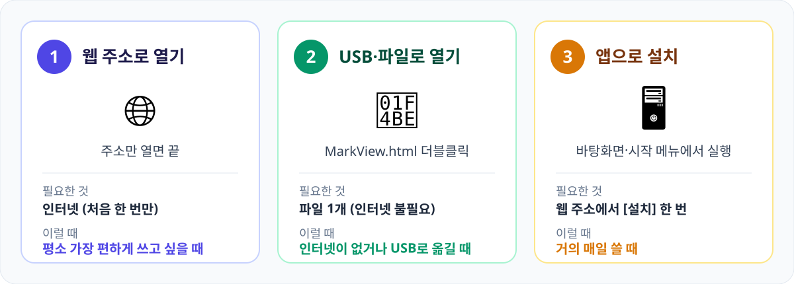
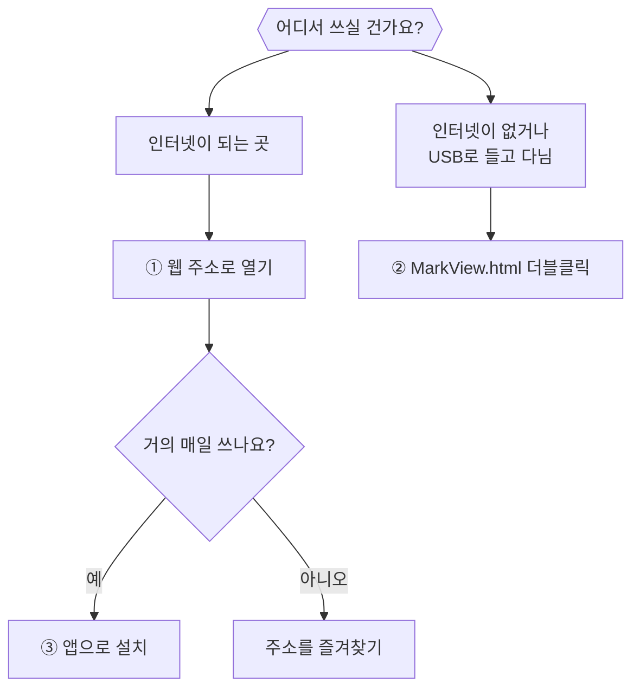
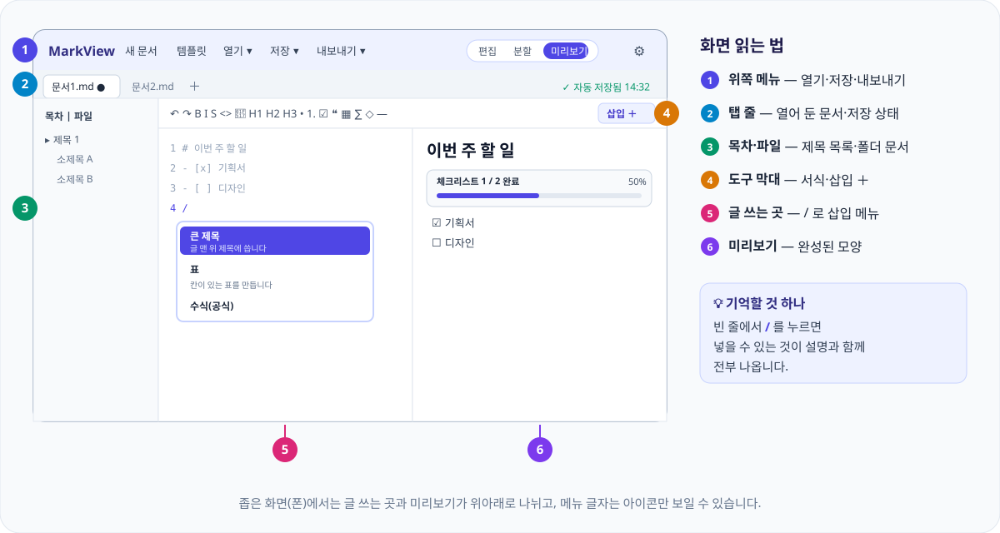
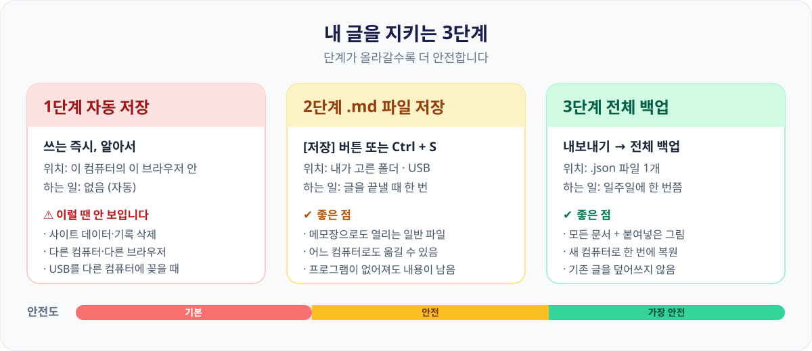
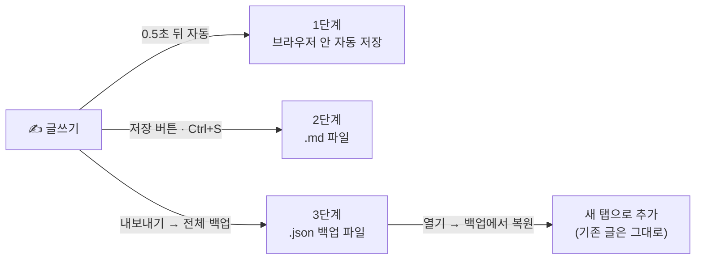
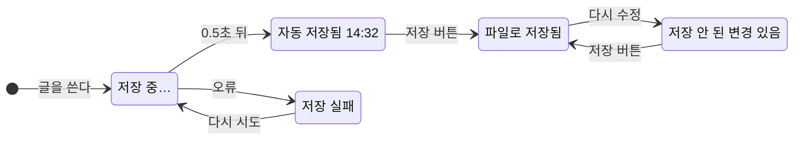
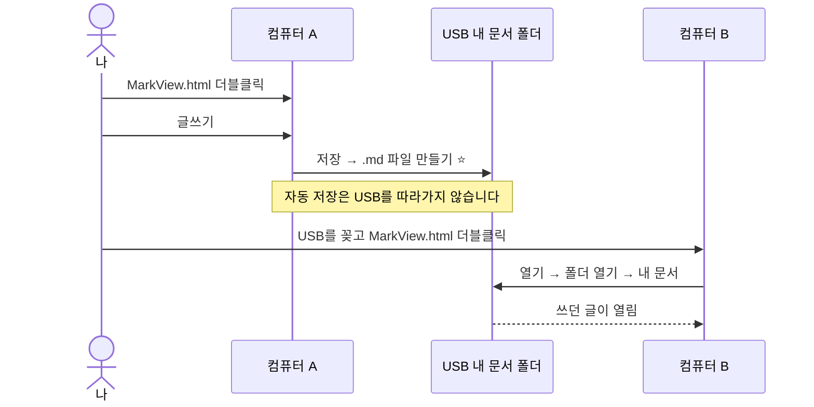
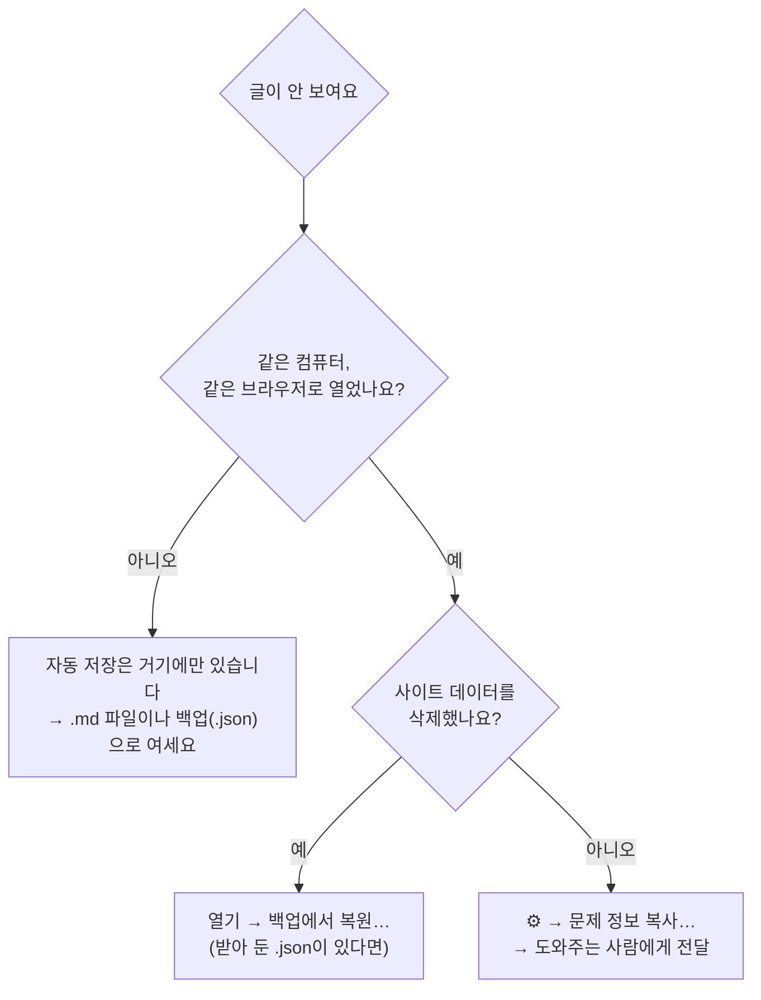
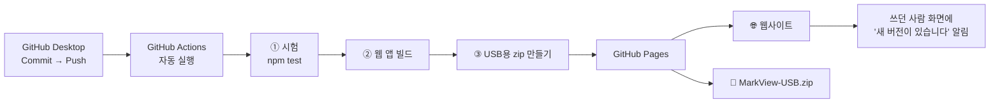

<p align="center">
  
</p>

<p align="center">
  <a href="https://sh11025.github.io/MarkView/"><b>🌐 바로 쓰기</b></a>
  &nbsp;·&nbsp;
  <a href="https://sh11025.github.io/MarkView/MarkView-USB.zip"><b>💾 USB용 파일 받기 (약 4MB)</b></a>
</p>

**MarkView**는 쓰는 즉시 완성된 모양을 보여 주는 글쓰기 도구입니다.
마크다운을 몰라도 됩니다. 빈 줄에서 `/` 를 누르면 제목·표·수식·그림을 **설명을 보며 골라 넣을 수 있습니다.**

- **서버로 보내지 않습니다.** 글은 내 컴퓨터 안에만 있습니다.
- **인터넷이 끊겨도 됩니다.** 한 번 열어 두면 비행기 안에서도 씁니다.
- **USB에 넣어 가져다닐 수 있습니다.** 파일 하나를 더블클릭하면 끝입니다.

> ⚠️ 글을 잃지 않으려면 [6. 저장과 백업](#6-저장과-백업-꼭-읽어-주세요)을 꼭 한 번 읽어 주세요.

<p align="center">
  
</p>

---

## 목차

| | | |
| --- | --- | --- |
| [1. 쓰는 3가지 방법](#1-쓰는-3가지-방법) | [7. 내보내기와 인쇄](#7-내보내기와-인쇄) | [13. 마크다운 문법표](#13-마크다운-문법표) |
| [2. 처음 5분](#2-처음-5분-글-하나-써-보기) | [8. 여러 문서와 폴더](#8-여러-문서와-폴더) | [14. 문제 해결](#14-문제-해결) |
| [3. 화면 구성](#3-화면-구성) | [9. USB로 가지고 다니기](#9-usb로-가지고-다니기) | [15. 인터넷에 올리기](#15-인터넷에-올리기-github-pages) |
| [4. 글쓰기 도우미](#4-글쓰기-도우미) | [10. 오프라인과 앱 설치](#10-오프라인과-앱-설치) | [16. 개발자 안내](#16-개발자-안내) |
| [5. 보기 설정](#5-보기-설정) | [11. 지원 브라우저](#11-지원-브라우저) | |
| [6. 저장과 백업](#6-저장과-백업-꼭-읽어-주세요) | [12. 단축키](#12-단축키) | |

---

## 1. 쓰는 3가지 방법

<p align="center">
  
</p>



### ① 웹 주소로 열기
<https://sh11025.github.io/MarkView/> 를 **Chrome 또는 Edge**로 엽니다. 끝입니다.
한 번 열어 두면 인터넷이 끊겨도 같은 주소로 열립니다.

### ② USB·파일로 열기
1. [MarkView-USB.zip](https://sh11025.github.io/MarkView/MarkView-USB.zip)을 내려받아 압축을 풉니다.
2. `MarkView.html` 을 **더블클릭**합니다.
3. 다른 브라우저가 열리면 파일을 오른쪽 클릭 → **연결 프로그램** → Chrome 또는 Edge를 고릅니다.

### ③ 앱으로 설치
웹 주소로 열었을 때 주소창 오른쪽의 **설치** 아이콘, 또는 화면 위쪽의 **설치** 버튼을 누릅니다.
([10. 오프라인과 앱 설치](#10-오프라인과-앱-설치) 참고)

---

## 2. 처음 5분: 글 하나 써 보기


1. **새 문서** 를 누릅니다. 새 탭이 열립니다.
2. 빈 줄에서 `/` → **큰 제목** 을 고르고 제목을 씁니다.
   (`/` 가 어렵다면 도구 막대 오른쪽 끝의 **삽입 ＋** 를 누르세요. 같은 메뉴가 열립니다.)
3. 내용을 씁니다. 쓰는 즉시 오른쪽(또는 아래)에 완성된 모양이 나타납니다.
4. 빈 줄에서 `/` → **표** 로 표를 넣습니다. 미리보기에서 표 위에 마우스를 올리면 칸을 늘리고 줄이는 버튼이 나옵니다.
5. 글을 끝낼 때 **저장**(또는 `Ctrl + S`)으로 `.md` 파일을 만들어 둡니다.

쓰는 동안은 **자동 저장**되지만, 이는 그 컴퓨터의 그 브라우저 안에만 남습니다. 자세한 내용은 [6번](#6-저장과-백업-꼭-읽어-주세요)에 있습니다.

---

## 3. 화면 구성

<p align="center">
  
</p>

| 이름 | 하는 일 |
| --- | --- |
| **새 문서** | 빈 문서를 새 탭으로 엽니다 |
| **템플릿** | 회의록·보고서 같은 서식 43종에서 골라 새 문서를 만듭니다 |
| **열기 ▾** | 파일 열기 · 폴더 열기 · 백업에서 복원 |
| **저장 ▾** | 저장 · 다른 이름으로 저장 |
| **내보내기 ▾** | HTML·마크다운 파일, 인쇄·PDF, 전체 백업 |
| **편집 \| 분할 \| 미리보기** | 화면을 나누는 방식. 좁은 화면에서는 위아래로 나뉩니다 |
| **⚙ 보기 설정** | 테마, 글자 크기, 줄 간격, 문제 정보 복사 |
| **탭 줄** | 열어 둔 문서. 이름은 **더블클릭**으로 바꾸고, `×` 나 가운데 버튼으로 닫습니다. 탭의 **●** 는 "파일에 저장하지 않은 변경이 있음" 표시입니다 |
| **저장 상태** | 탭 줄 오른쪽 끝에 지금 저장 상태가 나옵니다 |

화면이 좁으면 메뉴 이름이 아이콘만 보일 수 있습니다. 아이콘에 마우스를 올리면 설명이 나옵니다.

---

## 4. 글쓰기 도우미

### 4-1. `/` 삽입 메뉴

**빈 줄에서 `/` 를 누르면** 넣을 수 있는 것이 아이콘·쉬운 이름·한 줄 설명·결과 예시와 함께 나옵니다.

- `↓` `Enter` 또는 마우스 클릭으로 고릅니다. `Esc` 로 닫습니다.
- 이어서 글자를 입력하면 걸러집니다. 한글로 찾아도 됩니다. (예: `표`, `엑셀`, `할일`, `공식`, `순서도`, `웃음`)
- `/` 를 누르기 어려우면 도구 막대의 **삽입 ＋** 를 누르세요.

| 분류 | 넣을 수 있는 것 |
| --- | --- |
| **글 모양** | 큰·중간·작은 제목, 점 목록, 번호 목록, 체크리스트, 인용문 |
| **넣기** | 표, 코드 상자, 수식(공식), 다이어그램(그림), 이모지 |
| **상자** | 참고(파랑), 팁(초록), 중요(보라), 주의(주황), 경고(빨강) |
| **링크·기타** | 링크, 구분선, 템플릿으로 새 문서 만들기 |

굵게·기울임·취소선·코드 같은 글자 서식은 **도구 막대** 아이콘으로 합니다. 글자를 먼저 선택한 뒤 누르세요.

### 4-2. 체크리스트

`/` → **체크리스트**, 또는 `- [ ] 할 일` 로 씁니다.
**미리보기에서 체크박스를 누르면** 체크되고, 목록 위에 **"체크리스트 3 / 6 완료 50%"** 진행 막대가 나옵니다. 들여쓴 하위 항목도 함께 셉니다.

### 4-3. 표

- `/` → **표**, 또는 엑셀·구글 시트에서 복사한 표를 **그대로 붙여넣기** 하면 표가 됩니다.
- **미리보기에서 표에 마우스를 올리면** 편집 버튼이 나타납니다.

| 버튼 | 하는 일 |
| --- | --- |
| 표 아래쪽 `＋` 띠 | 맨 끝에 행(줄) 추가 |
| 표 오른쪽 `＋` 띠 | 맨 끝에 열(칸) 추가 |
| 줄 사이·칸 사이의 작은 `＋` | 그 자리에 끼워 넣기 |
| 줄 왼쪽의 `－` | 그 줄 삭제 |
| 칸 위쪽의 `－` | 그 열 삭제 |

- 칸의 글자는 **더블클릭**해서 고칩니다.
- 잘못 눌렀다면 `Ctrl + Z` 한 번으로 되돌립니다.

### 4-4. 수식

`/` → **수식(공식)** 에서 수학·과학 공식 **42종**을 미리 보고 고를 수 있습니다. 대수, 미적분, 선형대수, 확률·통계, 물리·공학으로 나뉘고 검색도 됩니다.
직접 쓸 때는 `$E=mc^2$` (글 속) 또는 `$$ … $$` (한 줄 크게)로 씁니다.

### 4-5. 다이어그램 (그림)

순서도, 시퀀스, 클래스, 상태, ER, 간트, 파이, 마인드맵 같은 그림을 글자로 그립니다.
`/` → **다이어그램(그림)** 에서 예시 **20종** 중 하나를 고르면 됩니다.

- **그림에 마우스를 올리면** `PNG로 저장` · `SVG로 저장` · `편집` 버튼이 나옵니다.
  - PNG는 흰 배경의 고화질 그림이라 문서·발표자료에 붙이기 좋습니다.
  - SVG는 확대해도 깨지지 않습니다.
- **그림을 더블클릭**하면 마우스로 상자를 옮기고 선을 잇는 **그림 편집기**가 열립니다. 적용하면 글도 함께 바뀌고 `Ctrl + Z` 로 되돌릴 수 있습니다.

### 4-6. 이모지와 색깔 상자

| 하고 싶은 것 | 방법 |
| --- | --- |
| 이모지 넣기 | `:smile:` → 😄, `:rocket:` → 🚀 (320여 종). `:` 와 두 글자(`:sm`)를 치면 후보가 뜹니다 |
| 색깔 상자 넣기 | `/` → 참고·팁·중요·주의·경고 상자 |
| 이모지 상자 | `> 💡 알아 두면 좋은 내용` 처럼 인용문 첫머리에 이모지. 지원: 💡 ⚠️ 🚨 🛑 ❗ ✅ ❌ ℹ️ 📌 🎯 🔥 📝 |

### 4-7. 이미지

- 캡처한 화면이나 복사한 그림을 **붙여넣기(`Ctrl + V`)** 하거나 글 쓰는 곳으로 **끌어다 놓으면** 들어갑니다.
- 미리보기에서 그림을 누르면 크게 보입니다. `Esc` 로 닫습니다.
- 붙여넣은 그림은 브라우저에 저장되고 글에는 연결 정보만 남습니다. **`.md` 파일에는 그림 자체가 들어가지 않으니**, 그림이 든 글을 옮길 때는 [HTML 내보내기](#7-내보내기와-인쇄)나 [전체 백업](#6-3-전체-백업)을 쓰세요.

### 4-8. 템플릿 43종

위쪽 **템플릿** 에서 카테고리를 누르거나 검색해 고릅니다. **"이 템플릿으로 새 문서"** 를 누르면 새 탭으로 열리며, **쓰던 글은 건드리지 않습니다.** `○○○` 로 표시된 곳을 채우면 되고, 날짜는 오늘로 자동 입력됩니다.

| 분류 | 템플릿 |
| --- | --- |
| **업무** (9) | 회의록, 주간 보고, 일간 업무 보고, 인수인계서, 1:1 면담 기록, 견적서, 출장 보고서, 프로젝트 기획서, 프로세스 문서 |
| **개발** (7) | 요구사항 명세, 장애 보고서, README, API 문서, 코드 리뷰 체크리스트, 변경 기록, 버그 리포트 |
| **개인** (7) | 할 일, 일기, 독서 노트, 여행 계획, 가계부, 습관 추적, 버킷리스트 |
| **학습** (6) | 학습 노트, 강의 노트(코넬식), 시험 대비, 단어장, 논문 읽기, 수학 공식 정리 |
| **기획·창작** (5) | 블로그 글, 보도자료, 이력서, 자기소개서, 발표 대본 |
| **일정·관리** (5) | 월간 계획, 프로젝트 일정표, 주간 식단표, 이사 체크리스트, 행사 준비 체크리스트 |
| **다이어그램** (4) | 순서도, 시퀀스, 조직도, 마인드맵형 정리 |

### 4-9. 서식 정리

도구 막대의 **서식 정리(✨)** 는 표 칸 너비, 목록 기호, 불필요한 공백·빈 줄을 정돈합니다. 코드 상자와 수식 안은 건드리지 않습니다. 마음에 안 들면 `Ctrl + Z` 로 되돌립니다.

---

## 5. 보기 설정

### 5-1. 보기 방식

위쪽의 **편집 | 분할 | 미리보기** 를 고릅니다.

- **편집**: 글 쓰는 곳만 크게
- **분할**: 왼쪽에 쓰고 오른쪽에 완성된 모양 (스크롤이 함께 움직입니다)
- **미리보기**: 완성된 모양만 크게. 이때도 체크박스와 표를 고칠 수 있습니다

### 5-2. ⚙ 보기 설정

| 항목 | 설명 |
| --- | --- |
| **테마 프리셋** | 시스템(컴퓨터 설정을 따름), GitHub 라이트, GitHub 다크, Dracula, Nord, Sepia, Monokai, Tokyo Night, Forest |
| **글자 크기 · 줄 간격** | 슬라이더로 조절 |
| **본문 폭 · 정렬** | 좁게/보통/넓게 · 왼쪽/양쪽 |
| **본문 글꼴** | 고딕 / 명조 / 고정폭 / 둥근 고딕 (컴퓨터에 있는 글꼴 사용) |
| **한글 단어 단위 줄바꿈** | 켜면 단어 중간에서 줄이 끊기지 않습니다 |
| **코드블록 줄바꿈** | 켜면 긴 코드 줄이 접히고, 끄면 옆으로 스크롤됩니다 |
| **설정 초기화** | 처음 상태로 되돌립니다 |
| **문제 정보 복사…** | 도움을 요청할 때 쓰는 기능 ([14번](#14-문제-해결) 참고) |

설정은 껐다 켜도 유지됩니다. **인쇄할 때는 어두운 테마를 써도 항상 흰 종이에 검은 글자**로 나옵니다.

### 5-3. 찾기

- **쓰는 중**: `Ctrl + F` → 찾기·바꾸기
- **미리보기 화면**: `Ctrl + F` → 검색 막대가 열리고 찾은 글자가 강조됩니다. `2 / 5` 처럼 몇 번째인지 나오며, `Enter` 다음 · `Shift + Enter` 이전 · `Esc` 닫기

### 5-4. 목차

왼쪽 **목차** 에 제목들이 나옵니다.

- 제목을 누르면 그 위치로 이동하고, 지금 읽는 부분이 표시됩니다.
- **전체 / H2까지 / H3까지** 로 보여 줄 깊이를 고르고, **제목 검색…** 으로 걸러냅니다.
- 제목 왼쪽 화살표로 하위 제목을 접고 펼칩니다.

긴 글에서는 위쪽에 **읽은 정도 막대**, 오른쪽 아래에 **맨 위로** 버튼이 나옵니다.

---

## 6. 저장과 백업 (꼭 읽어 주세요)

MarkView는 글을 서버로 보내지 않습니다. 대신 **3단계**로 지킵니다.

<p align="center">
  
</p>



### 6-1. 자동 저장

쓰는 동안 0.5초쯤 뒤에 자동 저장되고, 탭 줄 오른쪽 끝에 상태가 나옵니다.



| 표시 | 뜻 |
| --- | --- |
| 저장 중… | 저장하는 중입니다 |
| 자동 저장됨 14:32 | 브라우저 안에 저장되었습니다 |
| 파일로 저장됨 | 내 `.md` 파일에도 저장되어 있습니다 |
| 저장 안 된 변경 있음 | 파일에는 아직 저장하지 않은 내용이 있습니다. **저장** 을 누르세요 |
| 저장 실패 — 다시 시도 | 누르면 다시 시도합니다. 계속되면 바로 [전체 백업](#6-3-전체-백업)을 받으세요 |
| 이 컴퓨터에 저장되지 않는 임시 모드 | 브라우저가 저장을 막은 상태입니다. 닫으면 사라지니 **저장** 으로 파일을 만드세요 |

> ⚠️ **자동 저장은 "그 컴퓨터, 그 브라우저" 안에만 있습니다.** 아래 경우에는 사라지거나 안 보입니다.
> - 브라우저의 "인터넷 사용 기록 삭제 / 사이트 데이터·쿠키 삭제"를 실행했을 때
> - 다른 컴퓨터나 다른 브라우저로 열었을 때, USB를 다른 컴퓨터에 꽂았을 때
> - 시크릿(InPrivate) 창에서 쓰다가 창을 닫았을 때

### 6-2. 파일로 저장 (.md)

- **저장** 또는 `Ctrl + S`
  - **Chrome·Edge**: 처음에 위치를 묻고, 이후에는 **같은 파일에 덮어써서** 저장합니다.
  - **Firefox 등**: 누를 때마다 다운로드 폴더에 새 파일이 내려받아집니다.
- **저장 ▾ → 다른 이름으로 저장** 으로 위치·이름을 정할 수 있습니다.
- `.md` 는 메모장으로도 열리는 **일반 텍스트 파일**이라, 프로그램이 사라져도 내용이 남습니다.

### 6-3. 전체 백업

**모든 문서와 붙여넣은 그림을 파일 하나로** 보관합니다.

| 하고 싶은 것 | 방법 |
| --- | --- |
| 백업 받기 | **내보내기 ▾ → 전체 백업 내려받기** → `MarkView-백업-날짜-시간.json` |
| 복원하기 | **열기 ▾ → 백업에서 복원…** → 파일 선택 → 확인 창에서 **복원하기** |

- 복원은 **지금 있는 글을 지우거나 덮어쓰지 않습니다.** 항상 새 탭으로 추가되고, 이름이 같으면 `(복원)` 이 붙습니다.
- 다른 컴퓨터로 글을 옮길 때도 이 방법이 가장 확실합니다.
- 받은 파일은 **USB나 클라우드**에도 한 부 복사해 두세요.

> 💡 **추천 습관**: 글을 끝낼 때 **저장**으로 `.md` 만들기, 일주일에 한 번쯤 **전체 백업** 받기.

### 6-4. 저장 공간

브라우저 저장 공간이 80% 이상 차면 알림이 나옵니다. **백업 내려받기** 를 누르고 필요 없는 글을 정리하세요.
(7일 이상 어떤 글에서도 쓰이지 않은 붙여넣기 그림은 시작할 때 자동 정리됩니다.)

---

## 7. 내보내기와 인쇄

**내보내기 ▾**

| 메뉴 | 결과 |
| --- | --- |
| **HTML 파일 (오프라인용)** | 인터넷 없이 열리는 **단일 파일**. 수식·그림·붙여넣은 이미지까지 들어 있어 공유하기 좋습니다 |
| **마크다운 파일 (.md)** | 글 원문을 `.md` 로 내려받습니다 |
| **인쇄 / PDF로 저장** | 인쇄 창이 열립니다. 프린터 대신 "PDF로 저장"을 고르면 PDF가 됩니다. 어두운 테마여도 **종이에는 흰 배경**으로 나옵니다 |
| **전체 백업 내려받기** | [6-3](#6-3-전체-백업) 참고 |

---

## 8. 여러 문서와 폴더

### 8-1. 탭
`＋` 로 새 탭, 이름 더블클릭으로 이름 바꾸기, `×` 로 닫기. 저장하지 않은 내용이 있으면 닫기 전에 확인 창이 뜹니다. 글 쓰는 위치와 스크롤 위치는 탭마다 기억합니다.

### 8-2. 파일 열기
**열기 ▾ → 파일 열기** 로 `.md` 파일을 엽니다. 파일을 **창 위로 끌어다 놓아도** 열립니다.

### 8-3. 폴더 열기
**열기 ▾ → 폴더 열기** 로 폴더를 고르면 왼쪽 **파일** 탭에 폴더 안 문서가 나타납니다.

- 파일을 누르면 새 탭으로 열립니다. 같은 파일을 또 눌러도 탭이 중복으로 생기지 않습니다.
- 문서 속 **상대 경로 그림**(``)과 **문서 간 링크**(`[다음 글](chapter2.md)`)가 폴더 기준으로 동작합니다.

| 브라우저 | 폴더 열기 |
| --- | --- |
| **Chrome / Edge** | ✅ 열기 + 폴더 안 파일에 **직접 저장** |
| **Firefox** | ✅ 열기. 저장은 다운로드 (원본을 덮어쓰지 않아 안전) |
| **Brave** | ✅ 열기. 기본은 다운로드 저장. 주소창에 `brave://flags/#file-system-access-api` 를 입력해 켜면 직접 저장. 앱에서 폴더 열기를 누르면 이 주소를 복사하는 버튼이 나옵니다 |

---

## 9. USB로 가지고 다니기

```
MarkView-USB/
├─ MarkView.html     ← 더블클릭하면 실행 (인터넷·설치 필요 없음)
├─ 사용법.txt         ← 요약 안내
└─ 내 문서/           ← 내가 쓴 .md 파일을 저장하는 곳
```



1. [MarkView-USB.zip](https://sh11025.github.io/MarkView/MarkView-USB.zip)을 내려받아 압축을 풀고 `MarkView-USB` 폴더를 통째로 USB에 복사합니다. (파일은 새 버전을 올릴 때마다 자동으로 최신으로 다시 만들어집니다.)
2. 어떤 컴퓨터에서든 USB를 꽂고 `MarkView.html` 을 더블클릭합니다. (Chrome·Edge 권장)
3. 글은 **저장** 으로 `내 문서` 에 `.md` 파일로 만들어 둡니다.
4. 다른 컴퓨터에서는 **열기 ▾ → 폴더 열기** 로 `내 문서` 를 고르면 이어 쓸 수 있습니다.

> ⚠️ **가장 중요한 점**: 자동 저장은 USB를 따라오지 않습니다. 다른 컴퓨터에서 어제 쓴 글이 안 보이는 것이 정상입니다. 반드시 **저장** 으로 `.md` 를 만들어 두세요.

**USB 버전에서 달라지는 점**
- 앱 설치 버튼이 없습니다. (설치는 웹 주소로 열었을 때만 됩니다.)
- 맨 위에 "이 컴퓨터의 브라우저에 임시 저장" 안내가 나옵니다. 위 주의사항과 같은 내용이니 닫아도 됩니다.
- 파일이 약 10MB인 것은 수식·그림 엔진이 모두 들어 있기 때문입니다.

---

## 10. 오프라인과 앱 설치

### 10-1. 인터넷 없이 쓰기
- **웹 주소로 쓰는 경우**: 한 번 열어 두면 이후 인터넷이 끊겨도 됩니다. 수식, 다이어그램, 템플릿, PNG 저장 등 **모든 기능이 인터넷 없이 동작**합니다.
- **USB·파일로 쓰는 경우**: 처음부터 인터넷이 필요 없습니다.

### 10-2. 앱으로 설치

| 환경 | 방법 |
| --- | --- |
| **PC (Chrome, Edge)** | 웹 주소로 연 뒤 주소창 오른쪽의 **설치** 아이콘, 또는 화면 위쪽의 **설치** 버튼 |
| **안드로이드 Chrome** | 메뉴(⋮) → **앱 설치** 또는 **홈 화면에 추가** |
| **아이폰 Safari** | 공유 버튼 → **홈 화면에 추가** |

### 10-3. 새 버전이 나왔을 때

화면 아래에 **"새 버전이 있습니다. [새로고침]"** 이 나타납니다.

- **쓰던 글은 사라지지 않습니다.** 자동으로 새로고침하지 않고, **직접 누를 때만** 바뀝니다.
- 글을 정리한 뒤 **[새로고침]** 을 누르면 새 버전이 됩니다. 저장된 글은 업데이트해도 그대로입니다.

---

## 11. 지원 브라우저

| 브라우저 | 사용 | 파일 저장 | 폴더 열기 | 비고 |
| --- | :---: | --- | --- | --- |
| **Chrome** (최신) | ✅ | 같은 파일에 덮어쓰기 | ✅ 직접 저장 | **권장** |
| **Edge** (최신) | ✅ | 같은 파일에 덮어쓰기 | ✅ 직접 저장 | **권장** |
| **Firefox** (최신) | ✅ | 다운로드 | ✅ 열기만 | 일부 붙여넣기 동작이 다를 수 있음 |
| **Brave** | ✅ | 기본은 다운로드 | ✅ | [8-3](#8-3-폴더-열기) 참고 |
| **Safari** | 미확인 | 다운로드 | – | 점검하지 못했습니다 |
| **폰 브라우저** | ✅ | 다운로드 | – | 위아래 분할 화면. 설치해서 쓰기를 권장합니다 |

덮어쓰기 저장을 쓸 때는 브라우저가 먼저 허락을 묻습니다. 또 **디스크의 파일이 밖에서 바뀌었는데 내가 쓰던 내용이 있으면**, 내 글을 덮어쓰지 않고 알려 줍니다.

---

## 12. 단축키

일부러 4개로 줄였습니다. 나머지는 버튼과 메뉴로 합니다. (맥은 `Ctrl` 대신 `Cmd`)

| 키 | 하는 일 |
| --- | --- |
| `Ctrl + S` | 저장 |
| `Ctrl + F` | 찾기 (쓰는 화면: 찾기·바꾸기 / 미리보기: 글 안 검색) |
| `Ctrl + Z` | 실행 취소 |
| `Ctrl + Y` | 다시 실행 |

빈 줄에서 `/` 를 누르면 **삽입 메뉴**가 열립니다. (단축키가 아니라 입력 방식입니다.)

---

## 13. 마크다운 문법표

`/` 메뉴와 도구 막대를 쓰면 몰라도 됩니다. 직접 쓰고 싶을 때만 참고하세요.

| 보이는 결과 | 쓰는 법 |
| --- | --- |
| 큰 / 중간 / 작은 제목 | `# 제목` / `## 제목` / `### 제목` |
| **굵게** · *기울임* · ~~취소선~~ | `**굵게**` · `*기울임*` · `~~취소선~~` |
| `코드` | `` `코드` `` |
| 링크 | `[보이는 글자](https://주소)` |
| 이미지 | `` |
| 점 목록 / 번호 목록 | `- 항목` / `1. 항목` |
| 체크리스트 | `- [ ] 할 일` · `- [x] 한 일` |
| 인용문 / 구분선 | `> 인용할 글` / `---` |
| 코드 상자 | 앞뒤를 ` ``` ` 로 감쌉니다 |
| 수식 | `$E=mc^2$` 또는 `$$ … $$` |
| 다이어그램 | ` ```mermaid ` 로 시작하는 코드 상자 안에 씁니다 |
| 참고·팁·중요·주의·경고 상자 | `> [!NOTE]` 다음 줄에 `> 내용` (`TIP` `IMPORTANT` `WARNING` `CAUTION`) |
| 이모지 상자 · 이모지 | `> 💡 내용` · `:smile:` |

표 예시:

```
| 이름 | 나이 |
| --- | --- |
| 가나 | 20 |
| 다라 | 30 |
```

한글 문장 속 `**"인용"**은`, `**내용:**내용` 처럼 따옴표·괄호·쌍점 바로 뒤에 글자가 붙어도 굵게가 정상 표시되도록 보정되어 있습니다.

---

## 14. 문제 해결



**Q. 하얀 화면이 되거나 오류 화면이 나와요.**
1. 화면의 **백업 내려받기** 를 먼저 누르세요. (글 보호가 우선입니다.)
2. 브라우저 새로고침(`F5`)을 합니다.
3. 계속되면 ⚙ → **문제 정보 복사…** 를 눌러 도와주는 사람에게 붙여 넣으세요.
   이 정보에는 브라우저 종류·화면 크기·오류 메시지·문서 개수 같은 기술 정보만 들어 있고, **내 글 내용·파일 이름·폴더 경로는 들어 있지 않습니다.**

**Q. 저장 상태에 "저장 실패" 또는 "임시 모드"가 나와요.**
브라우저가 저장 공간을 막은 상태입니다(시크릿 창, 공간 부족, 브라우저 설정 등). **저장** 으로 `.md` 를 만들어 두세요. 임시 모드에서도 **전체 백업**은 받을 수 있습니다.

**Q. USB를 다른 컴퓨터에 꽂았더니 어제 쓴 글이 안 보여요.**
정상입니다. 자동 저장은 USB를 따라가지 않습니다. **열기 ▾ → 폴더 열기** 로 `내 문서` 폴더를 열어 저장해 둔 `.md` 를 불러오세요.

**Q. 표 편집 버튼(＋, －)이 안 보여요.**
**미리보기 화면**에서 표 위에 마우스를 올려야 합니다. 폰에서는 표를 터치하세요. 인용문이나 목록 **안에 들어 있는 표**는 안전을 위해 미리보기 편집을 막아 두었으니, 글 쓰는 곳에서 직접 고치세요.

**Q. 수식이나 그림이 빨간 오류로 나와요.**
수식(`$…$`)이나 다이어그램의 문법이 틀린 것입니다. 오류 메시지의 줄 번호를 보고 고치거나, `/` 메뉴의 예시를 골라 고쳐 보세요. 다이어그램 글자에 괄호가 있다면 큰따옴표로 감쌉니다. 예: `A["인증(JWT)"]`

**Q. Firefox에서 엑셀 표를 붙여넣어도 표가 안 돼요.**
브라우저마다 붙여넣기 동작이 달라 생길 수 있는 알려진 의심 항목입니다. `/` → **표** 로 틀을 만들어 쓰거나 Chrome·Edge를 써 주세요.

**Q. 인쇄하면 배경이 어둡게 나오나요?**
아니요. 어두운 테마여도 **흰 종이에 검은 글자**로 나옵니다.

**Q. 내 글을 누가 볼 수 있나요?**
MarkView는 글을 어디로도 전송하지 않습니다. 광고·분석 도구도 없고 외부 글꼴·외부 서비스도 쓰지 않습니다. 모든 것이 내 컴퓨터의 브라우저 저장소에 있습니다. 공용 컴퓨터에서 쓴 뒤에는 글을 저장해 가져가고, 브라우저의 사이트 데이터를 삭제하세요.

**Q. 폰에서 쓸 수 있나요?**
웹 주소로 열어 **홈 화면에 추가**하면 됩니다. 화면이 좁으면 편집/미리보기가 위아래로 나뉘고, 도구 막대의 **삽입 ＋** 로 같은 메뉴를 열 수 있습니다. `.md` 저장은 다운로드로 이루어집니다.

---

## 15. 인터넷에 올리기 (GitHub Pages)

> 이 장은 MarkView를 올려 두는 **관리자**를 위한 설명입니다. 쓰기만 하는 분은 건너뛰세요.
> GitHub Pages는 무료이며, 무료 계정에서는 저장소가 **공개(Public)** 여야 합니다. 저장소에는 글이 아니라 프로그램 코드만 있으므로 공개해도 안전합니다. 내 글은 **각자의 브라우저 안**에만 있습니다.



코드를 올리면(`main` 브랜치) **시험 → 빌드 → USB용 zip 생성 → 웹사이트 공개**가 자동으로 진행됩니다. (설정 파일: `.github/workflows/deploy.yml`)

### 15-1. 처음 한 번: 올리기 (GitHub Desktop)

1. [GitHub](https://github.com)에 가입·로그인하고 [GitHub Desktop](https://desktop.github.com)을 설치해 로그인합니다.
2. **File → Add local repository…** 로 **`markview` 폴더**(`package.json` 이 들어 있는 폴더)를 고릅니다. 상위 폴더가 아닙니다.
   - "Git 저장소가 아닙니다"가 나오면 **create a repository** 를 누릅니다.
3. **Commit to main** → **Publish repository** (공개로 설정).
   - `node_modules`, `dist`, `release` 같은 큰 폴더는 `.gitignore` 로 자동 제외됩니다.

### 15-2. GitHub Pages 켜기

1. 저장소 → **Settings → Pages**
2. **Build and deployment → Source** 를 **GitHub Actions** 로 바꿉니다.
3. **Actions** 탭에서 `Deploy to GitHub Pages` 가 초록색 ✔ 가 될 때까지 기다립니다. (몇 분)
   - Pages를 켜기 전에 시작된 실행은 실패할 수 있습니다. 그 실행을 열어 **Re-run all jobs** 를 누르세요.
4. 웹 주소가 나타납니다: `https://사용자이름.github.io/저장소이름/`
   (이 저장소: <https://sh11025.github.io/MarkView/>)

앱은 **하위 경로**에서도 동작하도록 만들어져 있어 따로 설정을 바꿀 필요가 없습니다.

### 15-3. 고친 뒤 다시 올리기

1. 파일을 고칩니다.
2. GitHub Desktop 에서 **Commit to main** → **Push origin**.
3. 몇 분 뒤 자동으로 새 버전이 공개됩니다. 이미 쓰던 사람에게는 **"새 버전이 있습니다. [새로고침]"** 이 나타나며, 쓰던 글은 사라지지 않습니다.

### 15-4. USB용 파일

따로 할 일이 없습니다. 올릴 때마다 USB용 zip이 자동으로 다시 만들어집니다.

- 내려받는 주소: `https://사용자이름.github.io/저장소이름/MarkView-USB.zip`
- 직접 만들려면 [16번](#16-개발자-안내)의 `npm run build:portable` → `release/MarkView-USB`

### 15-5. 대안: Netlify Drop

가입 없이 폴더를 끌어다 놓으면 주소가 생깁니다. `npm run build:web` 으로 `release/MarkView-Web` 을 만들고 <https://app.netlify.com/drop> 에 끌어다 놓으세요.

---

## 16. 개발자 안내

**필요한 것**: [Node.js](https://nodejs.org) 22 이상

```bash
npm install               # 처음 한 번: 필요한 부품 설치
npm run dev               # 개발용 실행
npm run typecheck         # 타입 검사
npm test                  # 단위 테스트
npm run test:e2e          # 브라우저 자동 점검 (Chromium)
npm run test:e2e:firefox  # 브라우저 자동 점검 (Firefox)
npm run build             # 웹 배포용 빌드 (dist/)
npm run build:web         # 웹 배포 패키지 (release/MarkView-Web)
npm run test:e2e:deploy   # 배포 점검 (하위 경로 + 오프라인)
npm run build:portable    # USB용 단일 HTML (release/MarkView-USB)
npm run test:e2e:portable # USB용(file://) 자동 점검
```

변경한 뒤에는 `npm run typecheck && npm test` 가 통과해야 합니다.

**기술 구성**: React 19 · Vite · TypeScript · Tailwind CSS · Zustand · IndexedDB(idb) · CodeMirror 6 · markdown-it · DOMPurify · KaTeX · highlight.js · Mermaid · vite-plugin-pwa · Vitest · Playwright

**알려진 제약**
- 폴더에 **직접 덮어쓰기 저장**은 Chrome·Edge(File System Access API)에서만 됩니다. 다른 브라우저는 다운로드로 저장합니다.
- 인용문·목록 안의 표는 미리보기에서 편집하지 않습니다(의도적 비활성).
- Firefox에서 엑셀 표 붙여넣기 자동 변환은 자동 시험으로 확인하지 못했습니다(직접 확인 필요).
- USB(포터블) 버전에는 서비스 워커와 앱 설치가 없습니다.

코드 구조와 지켜야 할 원칙(20개)은 [AGENTS.md](AGENTS.md)를 보세요.
